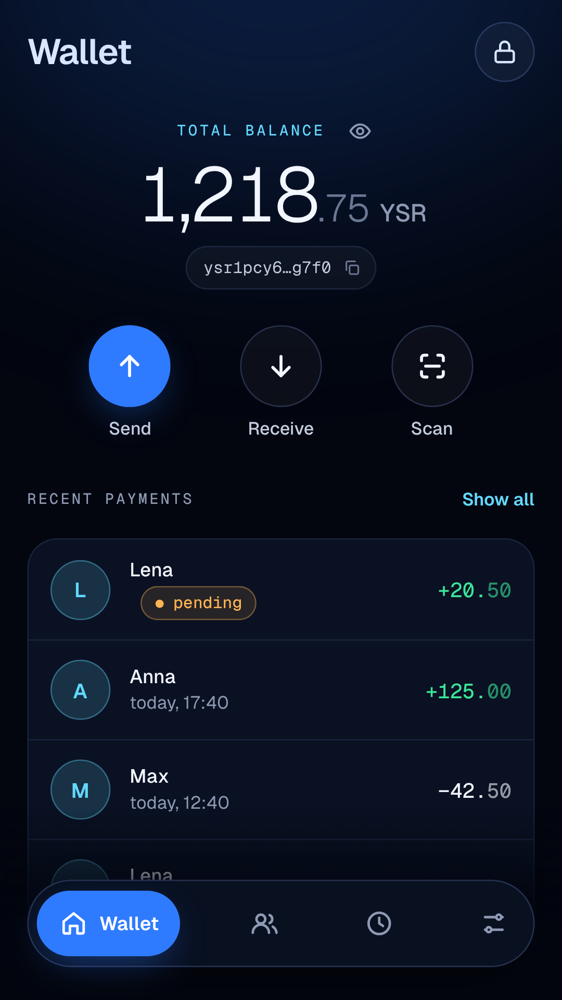
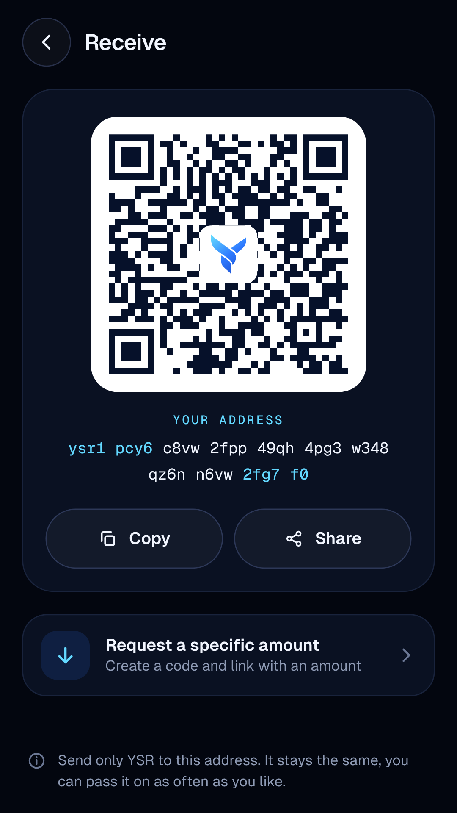
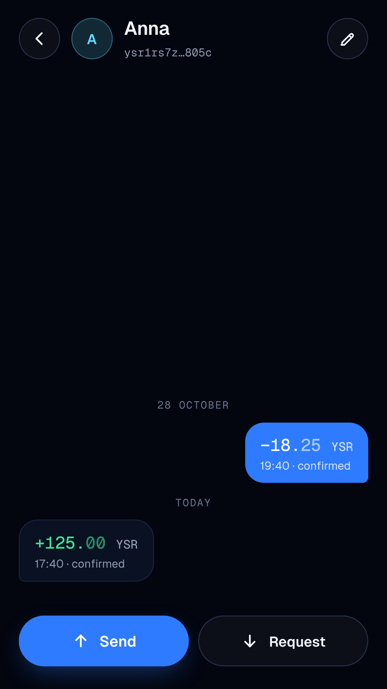
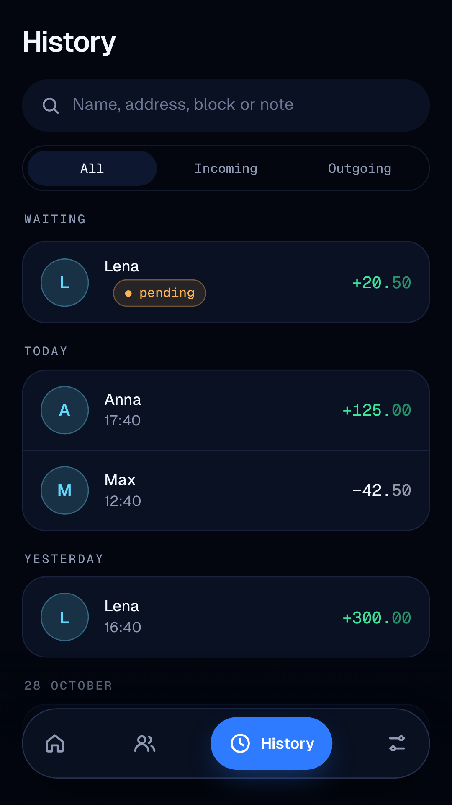
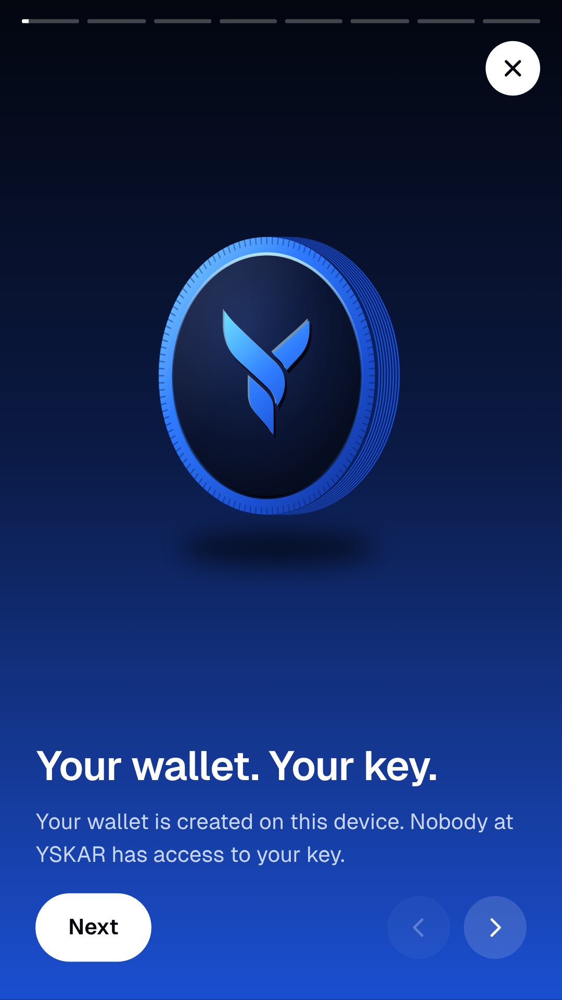

<p align="center">
  
</p>

<h1 align="center">YSKAR Wallet</h1>

<p align="center">
  The Android wallet for YSR, the currency of the YSKAR blockchain.<br>
  Send, receive and sign – your key stays on your device.
</p>

<p align="center">
  <a href="https://github.com/dabitlex/Wallet-/releases/latest"><b>Download the latest APK</b></a> ·
  <a href="https://www.yskar.app">yskar.app</a> ·
  <a href="https://t.me/yskar_official">Telegram channel</a> ·
  <a href="https://t.me/+GxAmtTMeG1w1M2Yy">Community</a>
</p>

<p align="center">
  
  
  
  
  
</p>

[Deutsch weiter unten](#deutsch)

## Features

**Your key stays with you**
- Your wallet is created on your phone. Nobody at YSKAR has access to your key.
- 12 recovery words restore your wallet on any device.
- The words are stored encrypted with your PIN in Android's protected storage and never go into cloud backups.

**Send and receive**
- Enter an address, pick a contact or scan a QR code.
- Before sending you see recipient, amount and network fee once more – then slide to confirm.
- Receive with your QR code or address, optionally requesting a specific amount.
- Amounts exact to the 8th decimal place; the overview can show 4 or 2 places if you prefer.

**Contacts and history**
- Contacts with names – all payments with one person in a single, chat-like history.
- Pending payments and confirmations at a glance.
- Optional notification for every incoming payment that is in a block.

**Security**
- PIN and fingerprint, auto-lock after a time you choose.
- No screenshots while the 12 words are on screen.
- The app's own keyboard: no input goes through your phone's keyboard app.

**Sign and sign in**
- Prove with a signed message that an address is yours, and verify other people's signatures.
- Sign in to YSKAR sites with a QR code. A signature cannot move YSR.

**Easy to learn** – an 8-step introduction explains every feature. English and German.

No ads, no tracking, no account with us.

## Install

1. Open the [latest release](https://github.com/dabitlex/Wallet-/releases/latest) on your Android phone (Android 7 or newer).
2. Download `yskar-wallet-<version>.apk` and open it.
3. Allow installing from this source when Android asks.

Updates install over the previous version – your wallet stays on the device.

**Check that the file is genuine.** Every release is signed with the same key. Its certificate fingerprint (SHA-256) is:

```
00:58:4F:99:42:4A:20:F5:AF:82:7B:8C:EE:47:B5:85:8D:10:47:60:80:EF:4D:3C:CA:D7:57:4A:87:B3:05:5F
```

Each release also lists the SHA-256 checksum of its APK. If the fingerprint differs, do not install the file.

## How it works

- **Keys:** the 12 words (BIP39) are generated on the device; every transfer is built and signed on the device. Only the finished, signed transfer is sent to a YSKAR node.
- **Reading:** balance, history and network fees come from the public YSKAR server `yskar.vercel.app`, which is queried with your public address.
- **Confirmed** means the payment is in a block.
- **No code from the internet:** the whole interface ships inside the APK.
- **Privacy:** see the [privacy policy](https://www.yskar.app/datenschutz). Addresses and transfers on the blockchain are public.

Never share your 12 words. Nobody from YSKAR will ever ask for them.

## For developers

React + TypeScript (Vite) in a Capacitor shell for Android. Keys, addresses and transfers come unchanged from the YSKAR core in [dabitlex/YSKAR](https://github.com/dabitlex/YSKAR); tests make sure the same 12 words give the same address and every transfer is byte-for-byte the same.

```bash
npm ci
npm test
npm run build
```

Building, signing and releasing: [docs/ENTWICKLUNG.md](docs/ENTWICKLUNG.md) (German).

## License

[MIT](LICENSE). YSKAR is an open community project.

---

<a id="deutsch"></a>

## Deutsch

Die YSKAR Wallet ist die Android-Wallet für YSR, die Währung der YSKAR-Blockchain. Senden, empfangen und signieren – dein Schlüssel bleibt auf deinem Gerät.

**Funktionen**
- Deine Wallet entsteht auf deinem Handy. Niemand bei YSKAR hat Zugriff auf deinen Schlüssel. Mit 12 Wörtern stellst du sie auf jedem Gerät wieder her; die Wörter liegen mit deiner PIN verschlüsselt im geschützten Speicher von Android und wandern nicht in Cloud-Sicherungen.
- Senden per Adresse, Kontakt oder QR-Code. Vor dem Senden siehst du Empfänger, Betrag und Netzgebühr noch einmal – dann schieben und bestätigen.
- Empfangen per QR-Code oder Adresse, auf Wunsch mit einem bestimmten Betrag. Beträge exakt bis zur 8. Nachkommastelle; in der Übersicht auf Wunsch mit 4 oder 2 Stellen.
- Kontakte mit Namen und allen Zahlungen in einem Verlauf wie in einem Chat. Wartende Zahlungen und Bestätigungen auf einen Blick, auf Wunsch eine Benachrichtigung bei jedem Eingang.
- PIN, Fingerabdruck und automatische Sperre. Keine Bildschirmfotos, solange die 12 Wörter zu sehen sind. Eigene Tastatur der App – keine Eingabe läuft über die Tastatur-App des Handys.
- Nachrichten signieren und Signaturen prüfen, Anmelden per QR-Code auf YSKAR-Seiten. Eine Signatur kann keine YSR bewegen.
- Eine Einführung in 8 Schritten erklärt alle Funktionen. Deutsch und Englisch.

Keine Werbung, kein Tracking, kein Konto bei uns.

**Installieren**
1. Das [neueste Release](https://github.com/dabitlex/Wallet-/releases/latest) auf dem Android-Handy öffnen (ab Android 7).
2. `yskar-wallet-<version>.apk` herunterladen und öffnen.
3. Die Installation aus dieser Quelle erlauben, wenn Android fragt.

Updates lassen sich über die vorige Fassung installieren, die Wallet bleibt erhalten.

**Echtheit prüfen:** Jedes Release ist mit demselben Schlüssel signiert. Der Fingerabdruck des Zertifikats (SHA-256) steht oben im englischen Teil, die Prüfsumme der APK auf jeder Release-Seite. Weicht der Fingerabdruck ab, die Datei nicht installieren.

Gib deine 12 Wörter niemals weiter. Niemand von YSKAR wird jemals danach fragen.

Lizenz: [MIT](LICENSE). YSKAR ist ein offenes Community-Projekt.
