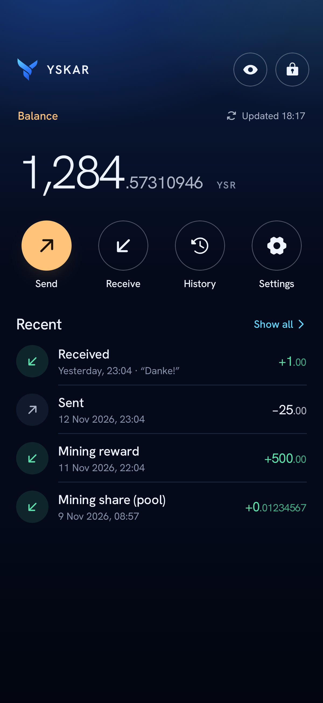
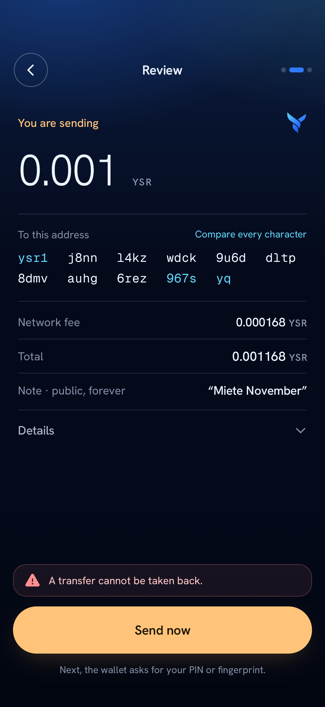
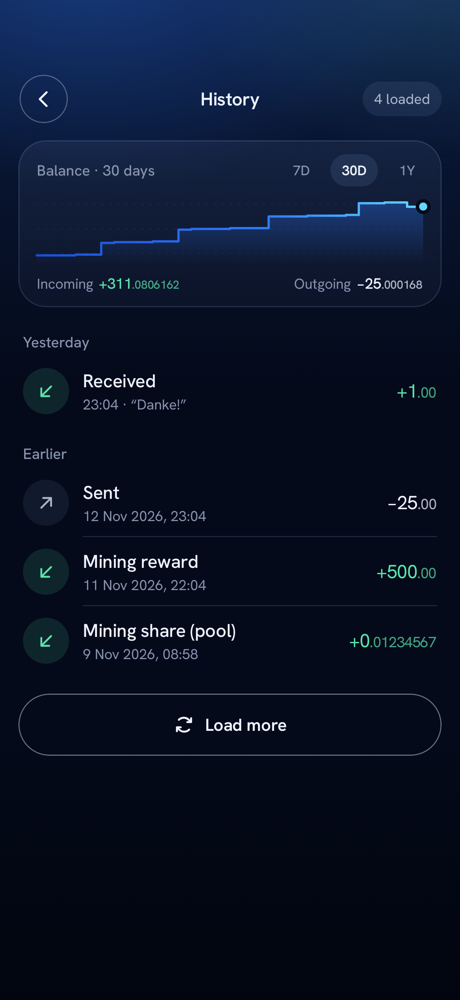
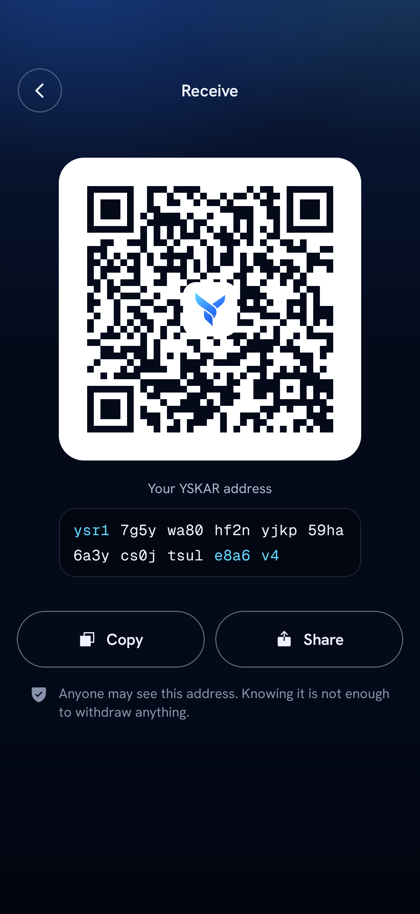
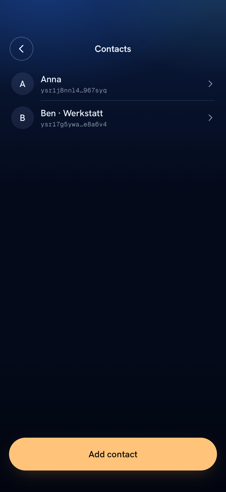
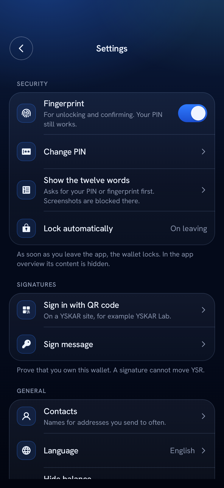

<p align="center">
  
</p>

<h1 align="center">YSKAR Wallet</h1>

<p align="center">
  The Android wallet for YSR, the currency of the YSKAR blockchain – built natively in Kotlin.<br>
  Send, receive and sign – your key stays on your device.
</p>

<p align="center">
  <a href="../../releases/latest"><b>Download the latest APK</b></a> ·
  <a href="https://www.yskar.app">yskar.app</a> ·
  <a href="https://t.me/yskar_official">Telegram channel</a> ·
  <a href="https://t.me/+GxAmtTMeG1w1M2Yy">Community</a>
</p>

<p align="center">
  
  
  
  
  
  
</p>

[Deutsch weiter unten](#deutsch)

Version 3 is a native rewrite. It replaces versions 1 and 2 of the YSKAR Wallet, which were built with web technology ([their code](../../tree/v2.0.0) stays in this repository). Keys, addresses and transfers are a Kotlin port of that wallet's core, checked value by value against the running original.

> **Coming from version 1 or 2? Read this first.**
> Android treats version 3 as a new app. It installs *next to* your old wallet – it does not update it, and your wallet does not move over by itself.
> 1. Make sure you have your 12 words on paper. Without them your YSR are lost.
> 2. Install version 3 and choose **Restore from twelve words**. Enter your 12 words.
> 3. Check that your balance is there.
> 4. Only then remove the old app.
>
> Version 3 is also signed with a new key, so its fingerprint differs from the one you know. That is expected; see [Install](#install).

## Features

**Your key stays with you**
- Your wallet is created on your phone. Nobody at YSKAR has access to your key.
- 12 recovery words restore your wallet on any device.
- The words are stored encrypted. The key for that comes from your PIN *and* a key in Android's protected key store that cannot be read out – six digits alone would not be enough.
- Nothing goes into cloud or ADB backups.
- Unlocked does not mean "key in memory": after unlocking, the app keeps only your public address. To sign, it asks again.

**Send and receive**
- Enter an address, pick a contact or scan a QR code.
- Before sending you see the full address, the amount, the network fee and the total – and you confirm with PIN or fingerprint right next to those numbers.
- An amount inside a scanned code is ignored. How much is sent is decided by you, on the device.
- Receive with your QR code or address.
- Amounts are exact to the 8th decimal place. Nothing is rounded.

**History and contacts**
- Your payments and your mining income (block rewards and pool shares) in one history, with a balance chart that is only drawn when the numbers add up.
- Contacts give addresses a name. The name is shown above the address, never instead of it.
- Block, transaction ID and the other technical details are one tap away – and from there the explorer.
- Optional notification for incoming payments. The phone checks by itself; there is no push server that knows your address.

**Security**
- PIN and fingerprint. The PIN is entered on the app's own keypad, not through your phone's keyboard app.
- The wallet locks as soon as you leave it and shows nothing in the app overview.
- No screenshots while the 12 words are on screen.
- Wrong PINs cost waiting time. The wallet never erases itself.

**Sign and sign in**
- Prove with a signed message that an address is yours.
- Sign in to YSKAR sites with a QR code. A signature cannot move YSR.

English and German. No ads, no tracking, no account with us. No Google Play Services needed.

## Install

1. Open the [latest release](../../releases/latest) on your Android phone (Android 8 or newer).
2. Download `yskar-wallet-<version>.apk` and open it.
3. Allow installing from this source when Android asks.

**Check that the file is genuine.** From version 3.0.0 on, every release is signed with the same key. Its certificate fingerprint (SHA-256) is:

```
C4:14:4B:D3:EA:94:10:C8:72:09:46:C2:B4:8A:3D:59:13:54:B0:55:18:FE:0C:15:A8:37:71:17:A2:66:0C:C6
```

Each release also lists the SHA-256 checksum of its APK. If the fingerprint differs, do not install the file.

Versions 1 and 2 were signed with a different key (`00:58:4F:99:…:B3:05:5F`). That key is no longer available, which is why version 3 could not be an update of the old app. A version 3 file carrying the *old* fingerprint, or any other than the one above, is not from us.

## How it works

- **Keys:** the 12 words (BIP39) are generated on the device; every transfer is built and signed on the device. Only the finished, signed transfer is sent to a YSKAR node (`pool.yskar.app`).
- **Reading:** balance, history and network fees come from the public YSKAR server `yskar.vercel.app`, which is queried with your public address.
- **Sent** means the node has accepted the transfer. **Confirmed** is shown after two confirmations.
- **Privacy:** see the [privacy policy](https://www.yskar.app/datenschutz). Addresses and transfers on the blockchain are public.

Never share your 12 words. Nobody from YSKAR will ever ask for them.

## For developers

Kotlin and Jetpack Compose, no web view. The package `com.yskar.wallet.kern` uses no Android API, so the tests of keys, addresses, transfers, vault and network layer run on the JVM without a device – more than 460 of them, against vectors and recorded answers taken from the running wallet and the public API.

```bash
./gradlew testDebugUnitTest
./gradlew assembleDebug
```

Toolchain: JDK 21, Gradle 9.9 (wrapper), Android Gradle Plugin 9.5.1, Kotlin 2.4.21, `compileSdk` 37.2, `targetSdk` 36, `minSdk` 26.

Documentation and code comments are in German:

| File | What it covers |
|---|---|
| [REGELN.md](REGELN.md) | The rules every change has to keep. Comments in the code refer to them by number. |
| [KERN.md](KERN.md) | Keys, addresses, transfers – and how the port is proven against the original |
| [TRESOR.md](TRESOR.md) | How the 12 words are stored on the device |
| [NETZ.md](NETZ.md) | Reading from the public server, sending to the node |
| [SENDEN.md](SENDEN.md) | The send flow and its checks |
| [OBERFLAECHE.md](OBERFLAECHE.md), [DESIGN.md](DESIGN.md) | Screens, colours, type, and how the interface is tested |

Three things to know before you run anything:

- **`OberflaecheTest` erases the wallet on the device before it starts.** Never run it on a phone that holds a real wallet. The other device tests do not touch it.
- No test talks to the real network, and none sends.
- Some comments and documents point to `bilder/`, `UMBAU.md` and `design-neu/`. Those are screenshots and working notes that are not part of this repository. The scripts in `werkzeug/` are the maintainer's Windows helpers and expect that setup.

Releases are built and signed with [`werkzeug/freigabe.ps1`](werkzeug/freigabe.ps1).

## License

[MIT](LICENSE). YSKAR is an open community project.

The app includes Bouncy Castle (MIT), the ZXing core (Apache 2.0), AndroidX and Jetpack Compose (Apache 2.0), the typefaces Hanken Grotesk and Geist Mono (SIL Open Font License 1.1) and Phosphor icons (MIT). The licence texts of the typefaces and icons are in [`app/src/main/assets/lizenzen`](app/src/main/assets/lizenzen).

---

<a id="deutsch"></a>

## Deutsch

Die YSKAR Wallet ist die Android-Wallet für YSR, die Währung der YSKAR-Blockchain – nativ in Kotlin gebaut. Senden, empfangen und signieren – dein Schlüssel bleibt auf deinem Gerät.

Version 3 ist neu gebaut und löst die Fassungen 1 und 2 ab, die mit Web-Technik entstanden sind ([ihr Code](../../tree/v2.0.0) bleibt in diesem Repository). Schlüssel, Adressen und Überweisungen sind deren Kern, nach Kotlin übertragen und Wert für Wert gegen das laufende Original geprüft.

> **Du kommst von Version 1 oder 2? Bitte zuerst lesen.**
> Für Android ist Version 3 eine neue App. Sie installiert sich *neben* deine alte Wallet – sie aktualisiert sie nicht, und deine Wallet zieht nicht von selbst um.
> 1. Stell sicher, dass du deine 12 Wörter auf Papier hast. Ohne sie sind deine YSR verloren.
> 2. Installiere Version 3 und wähle **Aus zwölf Wörtern wiederherstellen**. Gib deine 12 Wörter ein.
> 3. Prüfe, dass dein Guthaben da ist.
> 4. Erst dann entferne die alte App.
>
> Version 3 ist außerdem mit einem neuen Schlüssel signiert; ihr Fingerabdruck ist ein anderer als der, den du kennst. Das ist so gewollt, siehe „Echtheit prüfen".

**Funktionen**
- Deine Wallet entsteht auf deinem Handy. Niemand bei YSKAR hat Zugriff auf deinen Schlüssel. Mit 12 Wörtern stellst du sie auf jedem Gerät wieder her.
- Die Wörter liegen verschlüsselt auf dem Gerät. Der Schlüssel dafür entsteht aus deiner PIN *und* einem Schlüssel im geschützten Speicher von Android, der sich nicht auslesen lässt. In Sicherungen wandert nichts.
- Entsperrt heißt nicht „Schlüssel im Speicher": Nach dem Entsperren behält die App nur deine öffentliche Adresse. Zum Unterschreiben fragt sie erneut.
- Senden per Adresse, Kontakt oder QR-Code. Vor dem Senden siehst du die ganze Adresse, Betrag, Netzgebühr und Summe – und bestätigst mit PIN oder Fingerabdruck direkt neben diesen Zahlen. Ein Betrag in einem gescannten Code wird verworfen.
- Empfangen per QR-Code oder Adresse. Beträge exakt bis zur 8. Nachkommastelle, nichts wird gerundet.
- Zahlungen und Mining-Erträge in einem Verlauf, mit einem Guthaben-Diagramm, das nur gezeichnet wird, wenn die Rechnung aufgeht.
- Kontakte geben Adressen einen Namen. Der Name steht über der Adresse, nie an ihrer Stelle.
- Auf Wunsch eine Mitteilung bei jedem Eingang. Das Handy sieht selbst nach; es gibt keinen Push-Server, der deine Adresse kennt.
- PIN über das eigene Ziffernfeld der App, Fingerabdruck, Sperre beim Verlassen, nichts zu sehen in der App-Übersicht, keine Bildschirmfotos, solange die 12 Wörter zu sehen sind. Falsche PINs kosten Wartezeit; die Wallet löscht sich nie selbst.
- Nachrichten signieren, Anmelden per QR-Code auf YSKAR-Seiten. Eine Signatur kann keine YSR bewegen.
- Deutsch und Englisch.

Keine Werbung, kein Tracking, kein Konto bei uns. Keine Google-Play-Dienste nötig.

**Installieren**
1. Das [neueste Release](../../releases/latest) auf dem Android-Handy öffnen (ab Android 8).
2. `yskar-wallet-<version>.apk` herunterladen und öffnen.
3. Die Installation aus dieser Quelle erlauben, wenn Android fragt.

**Echtheit prüfen:** Ab Version 3.0.0 ist jedes Release mit demselben Schlüssel signiert. Der Fingerabdruck des Zertifikats (SHA-256) steht oben im englischen Teil, die Prüfsumme der APK auf jeder Release-Seite. Weicht der Fingerabdruck ab, die Datei nicht installieren. Die Fassungen 1 und 2 trugen einen anderen Schlüssel (`00:58:4F:99:…:B3:05:5F`); den gibt es nicht mehr, und darum konnte Version 3 kein Update der alten App sein.

**So arbeitet sie:** Die 12 Wörter entstehen auf dem Gerät, jede Überweisung wird dort gebaut und signiert. An den YSKAR-Knoten (`pool.yskar.app`) gehen nur fertige, signierte Bytes. Guthaben, Verlauf und Gebühren kommen vom öffentlichen YSKAR-Server `yskar.vercel.app`, der mit deiner öffentlichen Adresse gefragt wird. „Abgeschickt" heißt: vom Knoten angenommen. „Bestätigt" steht nach zwei Bestätigungen da.

Gib deine 12 Wörter niemals weiter. Niemand von YSKAR wird jemals danach fragen.

**Für Entwickler:** siehe oben. Regeln und Beweislage stehen in [REGELN.md](REGELN.md), [KERN.md](KERN.md), [TRESOR.md](TRESOR.md), [NETZ.md](NETZ.md) und [SENDEN.md](SENDEN.md).

Lizenz: [MIT](LICENSE). YSKAR ist ein offenes Community-Projekt.
